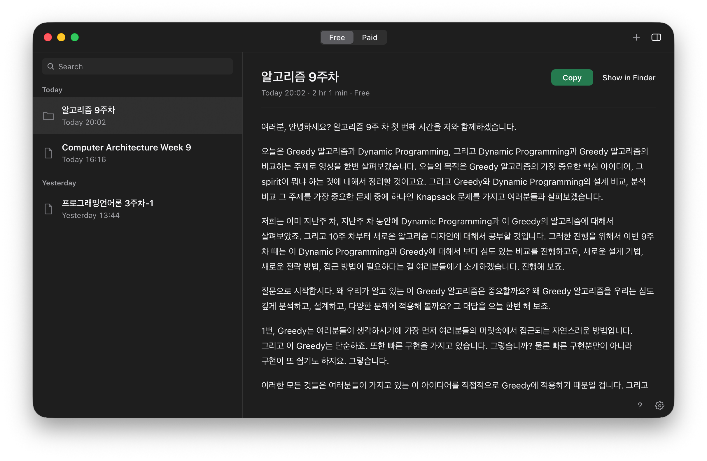
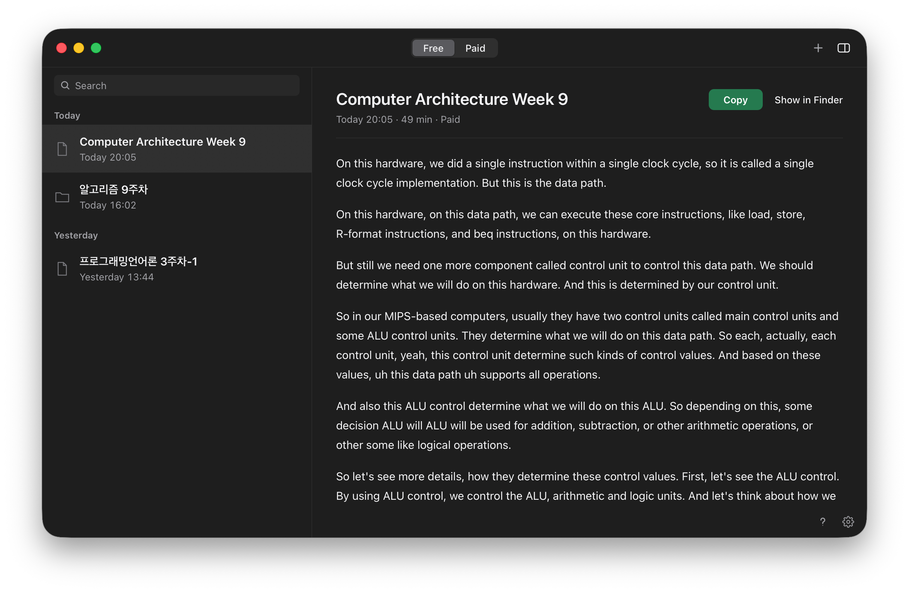
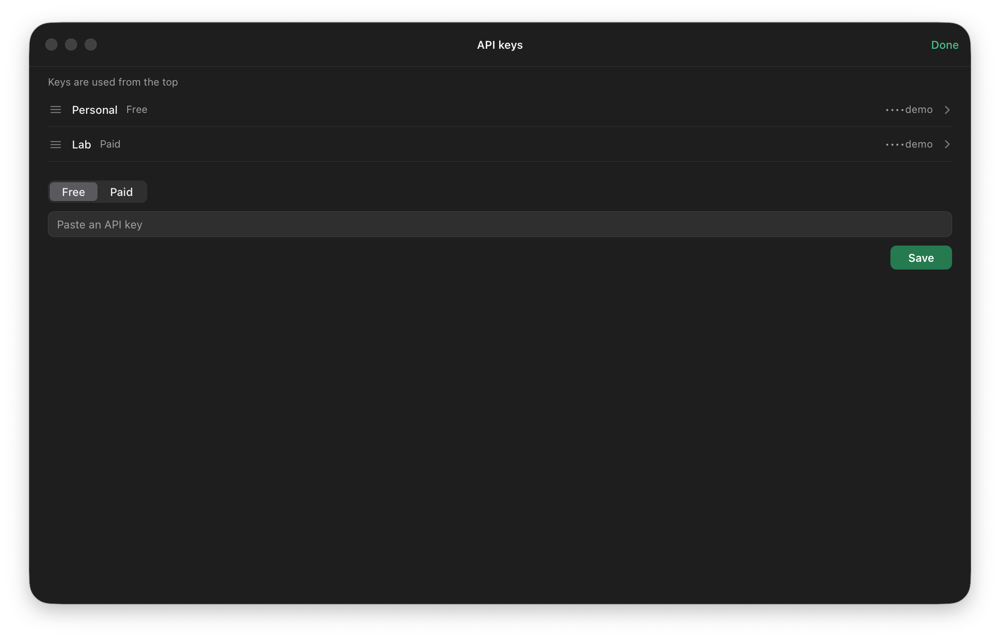

# Nalmeok (nalmeok)

> **시작하기** — [최신 버전 다운로드](https://github.com/jseook11/nalmeok/releases/latest) · [무료 API 키 발급](docs/gemini-api-key.md) · [Google AI Pro 크레딧으로 유료 키](docs/google-ai-pro-credit.md)

음성 파일이나 폴더를 창에 놓으면 전사한 `.md`가 원본 옆에 생겨요. 강의 전사본을 ChatGPT 프로젝트에 올려 쓰려고 만든 앱이에요.

- `.m4a`, `.mp4`(AAC), `.mp3`, `.wav`를 받아요.
- 폴더를 놓으면 안의 오디오를 이름 순서로 이어 `.md` 하나로 만들어요.
- 무료 키로 바로 전사해요. 유료로 처리하면 1시간에 약 74원이에요.
- 지난 작업은 목록에 남고, 검색할 수 있어요.
- OS 언어가 한국어면 한국어, 그 외에는 영어로 화면이 나와요.

<p>
  
  
</p>

## 설치

[Releases](https://github.com/jseook11/nalmeok/releases/latest)에서 내려받아요.

**macOS** — 내려받은 ZIP을 풀고 `Nalmeok.app`을 Applications 폴더로 옮긴 뒤 열어요. 서명·공증된 앱이라 경고 없이 열려요.

**Windows** — Windows용 실행 파일을 내려받아 더블클릭해요. SmartScreen 경고가 뜨면 **추가 정보 → 실행**을 눌러요.

**Windows (Scoop)** — [Scoop](https://scoop.sh)을 쓰면 명령으로 설치하고, 시작 메뉴에도 들어가요. 업데이트는 `scoop update nalmeok`이에요. 버킷을 추가하려면 git이 필요해서, 처음이면 첫 줄부터 실행해요.

```powershell
scoop install git
scoop bucket add nalmeok https://github.com/jseook11/scoop-bucket
scoop install nalmeok/nalmeok
```

## 처음 사용

1. 앱을 열어요. 키가 없으면 **API 키** 시트가 먼저 열려요.
2. **무료** 또는 **유료**를 고르고 **API 키 붙여넣기** 칸에 Gemini API 키를 넣어요. **저장**을 누르면 키를 확인하고 저장해요.
3. 음성 파일이나 폴더를 창에 놓아요. 확인 없이 바로 시작해요.
4. 끝나면 원본 옆에 `.md`가 생겨요. 끝난 행에서 **Finder에서 보기**(Windows는 **탐색기에서 보기**)를 누르면 파일 위치가 열려요.



키 발급과 등록은 [무료 Gemini API 키 발급과 등록](docs/gemini-api-key.md)에 사진과 함께 있어요. 무료 키는 바로 전사에, 유료 키는 Batch(대기 후 처리)에 써요. 두 종류를 모두 넣으면 위쪽 **무료** / **유료** 토글로 골라요. Google AI Pro 구독자라면 [월 $10 크레딧으로 유료 키를 쓸 수 있어요](docs/google-ai-pro-credit.md).

파일은 `강의09.m4a`를 놓으면 `강의09.md`, 폴더는 `ch07`을 놓으면 `ch07/ch07.md`로 원본 옆에 저장돼요.

## 더 알아보기

[사용 설명서](docs/usage.md)에 목록, 검색, 이름 변경, 비용, FAQ가 있어요. 키 발급은 [무료 키](docs/gemini-api-key.md)와 [Google AI Pro 크레딧으로 유료 키 쓰기](docs/google-ai-pro-credit.md)에 사진과 함께 정리했어요.

## 라이선스

MIT License
