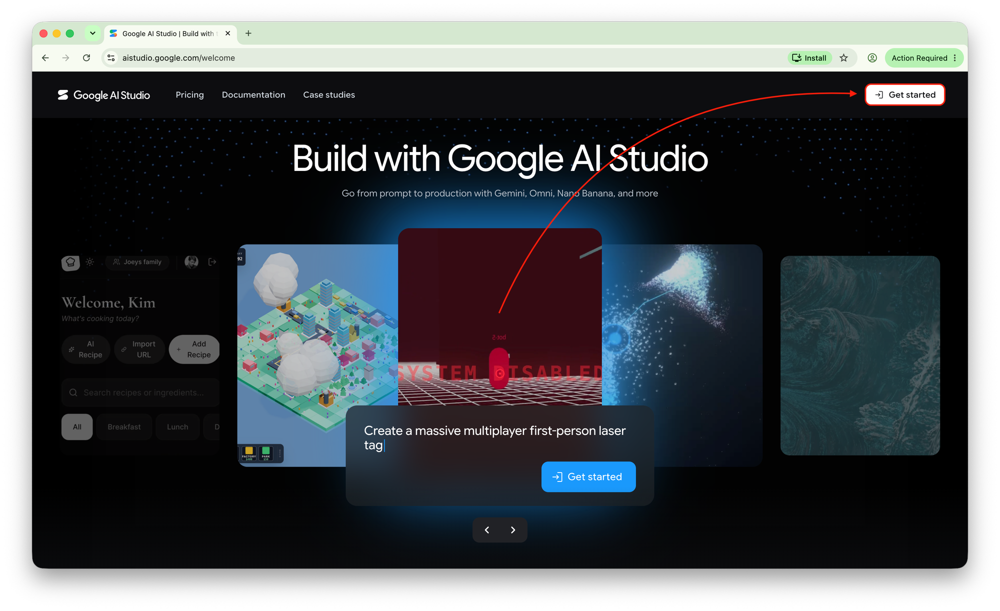
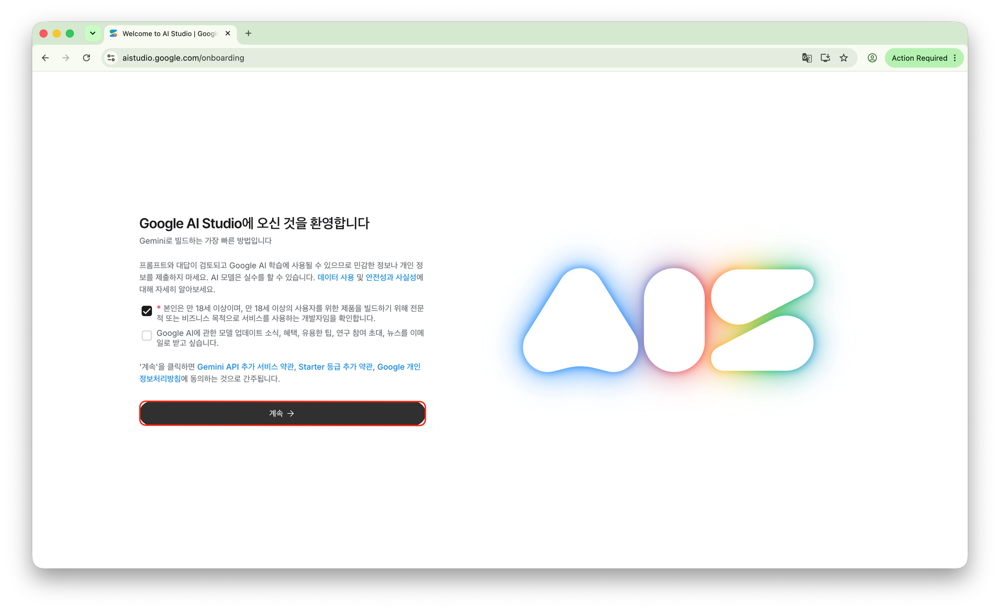
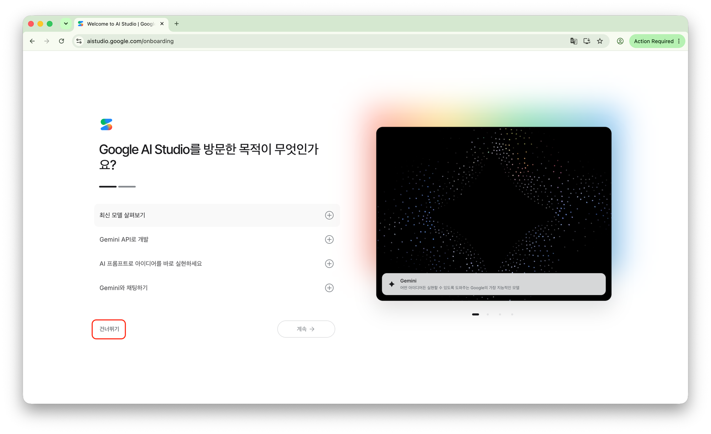
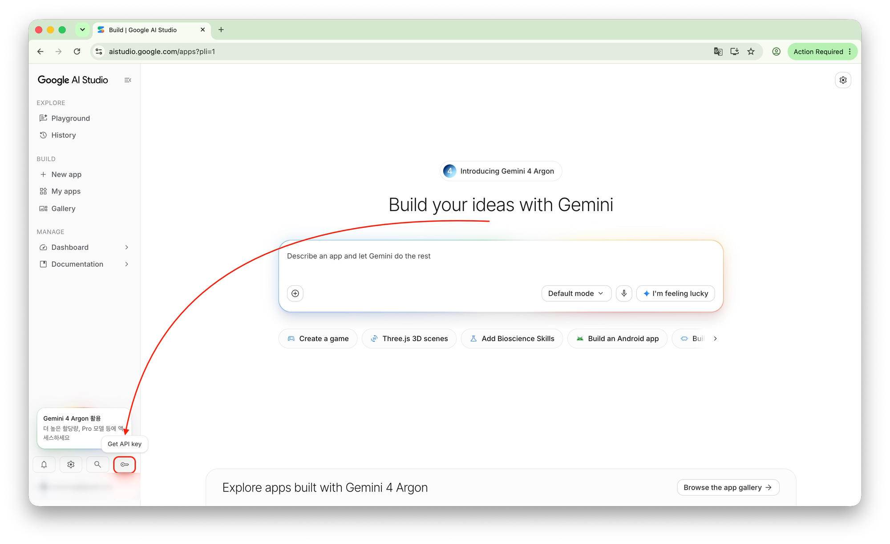
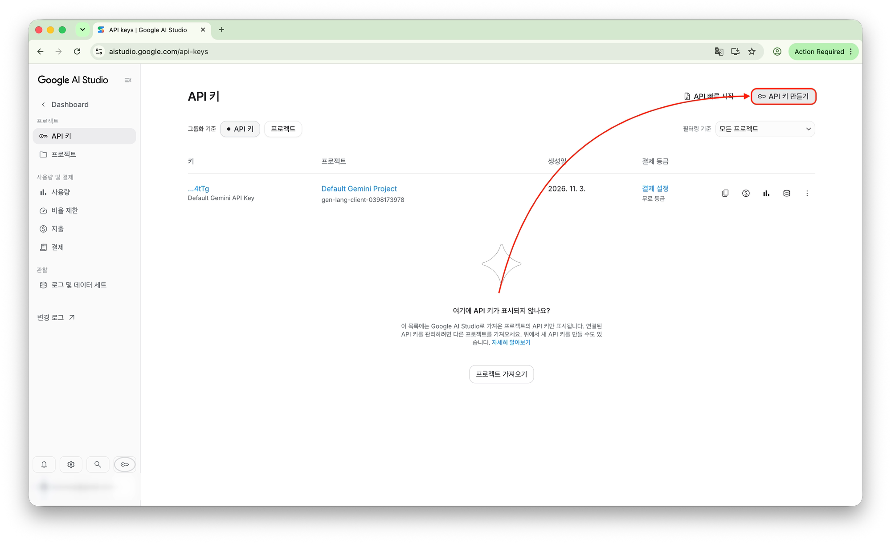
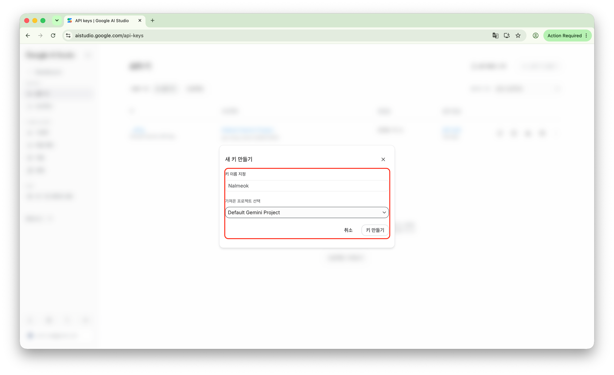
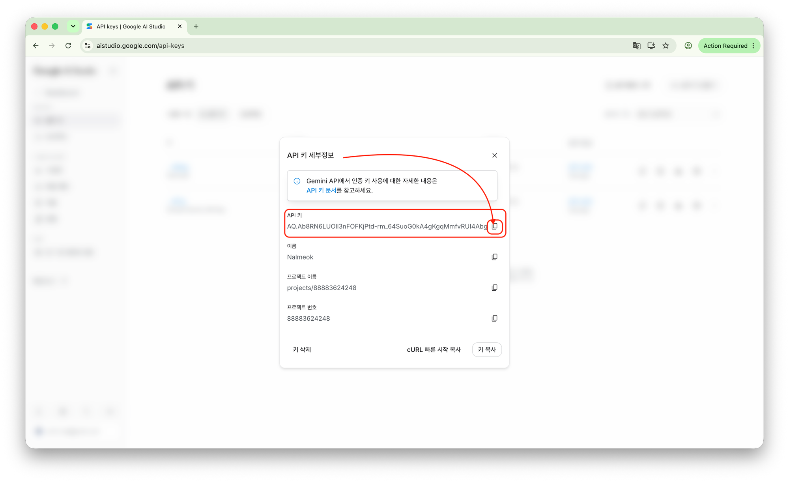
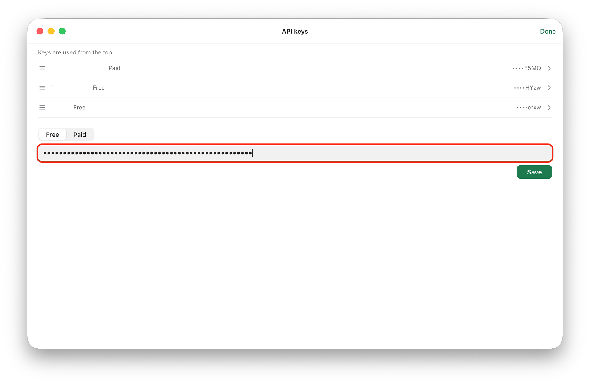

# 무료 Gemini API 키 발급과 등록

Nalmeok은 Google의 Gemini API로 강의 영상과 음성 파일을 텍스트로 바꿔요. Google AI Studio에서 무료 API 키를 받으면 따로 결제하지 않고 Nalmeok을 시작할 수 있어요.

> **유료 키를 권장하는 경우도 있어요.** Google AI Pro 구독자라면 매월 $10 크레딧으로 유료 키를 쓸 수 있어요. Pro 구독자가 아니어도 소액의 비용을 감당할 수 있다면 유료 키를 권장해요. 무료 키는 서버가 붐빌 때 응답 품질이 들쑥날쑥할 수 있거든요. 유료 키 설정은 [Google AI Pro 크레딧으로 유료 키 쓰기](google-ai-pro-credit.md)를 봐요.

이 글은 한국어 화면을 기준으로 해요. 영어 화면에서 보이는 이름은 괄호에 같이 적었어요.

## 1. Google AI Studio에 접속해요

[Google AI Studio](https://aistudio.google.com/)에 접속하고 **Get started**를 눌러요. Google 계정으로 로그인하면 돼요.

*사진 1 — Google AI Studio 시작 화면*

## 2. 처음 설정을 마쳐요

처음 접속하면 환영 화면과 함께 데이터 사용·약관 안내가 나와요.

1. 안내를 읽고 필수 확인란에 체크해요.
2. **계속**(Continue)을 눌러요.
3. **Google AI Studio를 방문한 목적이 무엇인가요?** 화면에서 목적을 고르거나 **건너뛰기**(Skip)를 눌러요.

*사진 2 — 환영 및 약관 안내*

*사진 3 — 방문 목적 선택*

## 3. API 키 관리 페이지로 가요

처음 설정을 마치면 Google AI Studio 메인 화면이 나와요. 왼쪽 아래의 **Get API key**를 누르거나, [API 키 관리](https://aistudio.google.com/api-keys)로 바로 가요.

*사진 4 — Google AI Studio 메인 화면*

## 4. 무료 API 키를 만들어요

API 키 관리 페이지에서 **API 키 만들기**를 눌러요. **새 키 만들기** 창이 열리면:

1. **키 이름 지정**에 이름을 넣어요. (예: `Nalmeok`)
2. **기존 프로젝트 선택**에서 **Default Gemini Project**를 골라요.
3. **키 만들기**를 눌러요.

결제를 연결하지 않은 프로젝트라면 무료 등급의 사용 한도가 적용돼요.

*사진 5 — API 키 관리 화면*

*사진 6 — 새 키 만들기*

## 5. 발급된 키를 복사해요

만든 키를 누르면 **API 키 세부정보**가 나와요. **API 키** 항목 옆의 복사 아이콘을 누르거나 오른쪽 아래의 **키 복사** 버튼을 눌러 키를 복사해요.

*사진 7 — 발급된 API 키 세부정보*

> API 키는 비밀번호와 같아요. 다른 사람에게 보내거나 공개된 GitHub 저장소에 올리지 마세요.

## 6. Nalmeok에 키를 등록해요

Nalmeok을 열고 **API 키**(영어 화면 **API keys**) 화면을 열어요. 키가 없는 채로 앱을 처음 열었다면 이 화면이 먼저 나와요.

1. **무료**(**Free**)를 골라요.
2. **API 키 붙여넣기**(**Paste an API key**) 칸에 복사한 키를 붙여넣어요.
3. **저장**(**Save**)을 눌러요. 결제 없이 키가 맞는지 확인한 뒤 저장해요.
4. 목록에 방금 넣은 키가 나오면 끝이에요. **완료**(**Done**)를 눌러 화면을 닫아요.

*사진 8 — Nalmeok API 키 등록*

이제 Nalmeok에서 무료 Gemini API를 쓸 수 있어요.

> 무료 키는 파일을 놓으면 바로 하는 전사에 써요. 유료(Batch)는 결제가 연결된 키가 있어야 해요. 두 키를 모두 넣으면 위쪽 **무료** / **유료** 토글로 골라요. 자세한 차이는 [사용 설명서](usage.md#무료-키와-유료-키)를 봐요. Google AI Pro 구독자라면 [월 $10 크레딧으로 유료 키를 쓸 수 있어요](google-ai-pro-credit.md).

## 자주 묻는 질문

**정말 무료인가요?**

네. Gemini API에는 무료 등급이 있어요. 쓸 수 있는 모델과 요청 횟수에 한도가 있고, 한도는 Google 정책에 따라 바뀔 수 있어요. 무료 등급은 입력한 내용이 Google 제품 개선에 쓰일 수 있으니, 민감한 강의는 유료 키를 쓰세요.

**신용카드를 등록해야 하나요?**

무료 등급으로 시작할 때는 보통 필요하지 않아요. 유료(Batch)를 쓰려면 결제 계정을 연결해야 해요.

**무료 사용량을 다 쓰면 어떻게 되나요?**

한도에 닿으면 요청이 제한될 수 있어요. Nalmeok에서는 항목이 **오늘 무료 사용량 소진**으로 바뀌고, 유료 키가 있으면 **유료로 이어서** 버튼이 보여요. 한도가 초기화되면 다시 무료로 쓸 수 있어요.

**이미 Gemini API 키가 있는데 새로 받아야 하나요?**

아니요. 쓰던 키가 유효하고 필요한 API에 접근할 수 있다면 그대로 Nalmeok에 등록하면 돼요.

## 관련 링크

- [Google AI Studio](https://aistudio.google.com/)
- [Gemini API 키 관리](https://aistudio.google.com/api-keys)
- [Gemini API 요금과 무료 사용 한도](https://ai.google.dev/gemini-api/docs/pricing)
- [Nalmeok 다운로드](https://github.com/jseook11/nalmeok/releases/latest)
- [Nalmeok 사용 설명서](usage.md)
