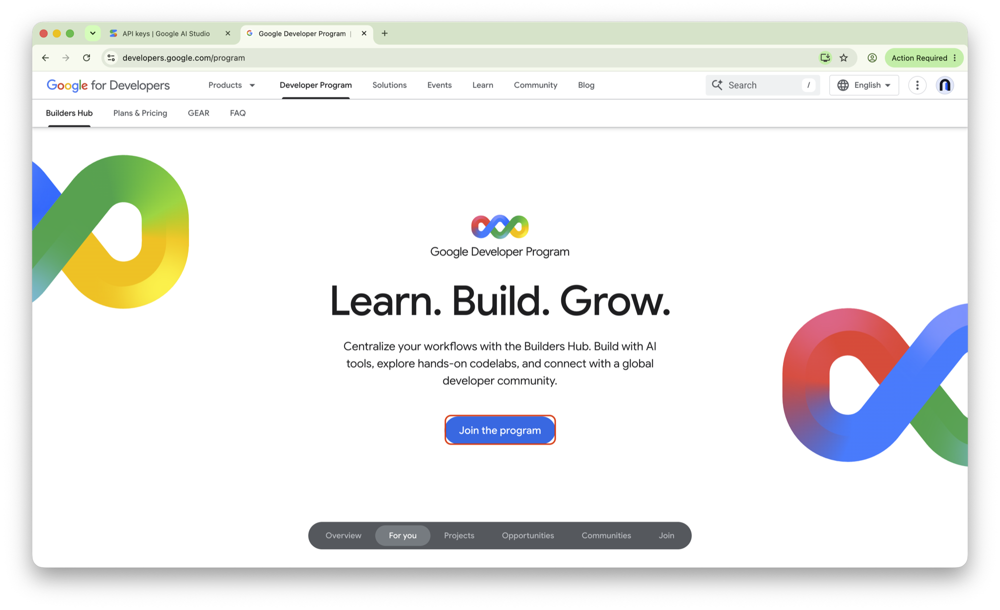
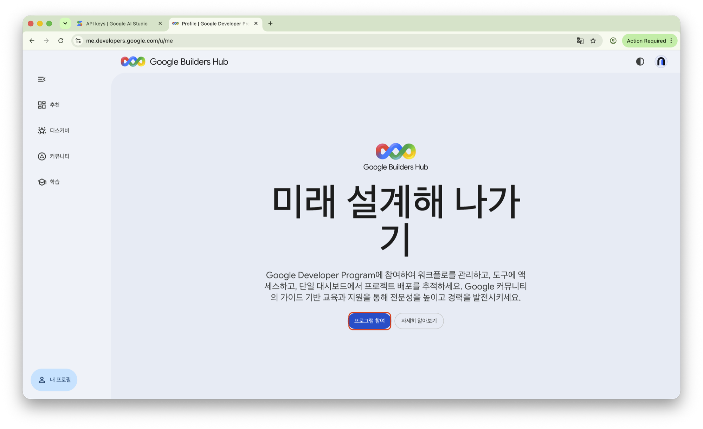
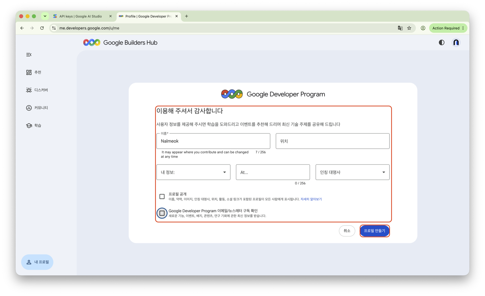
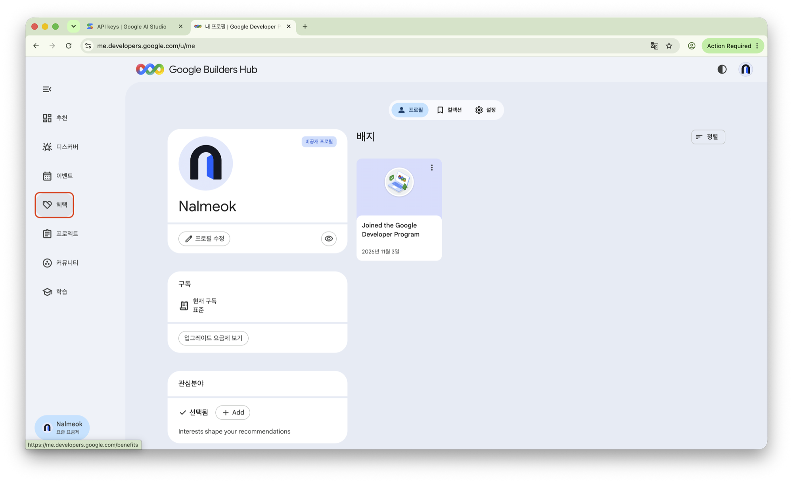
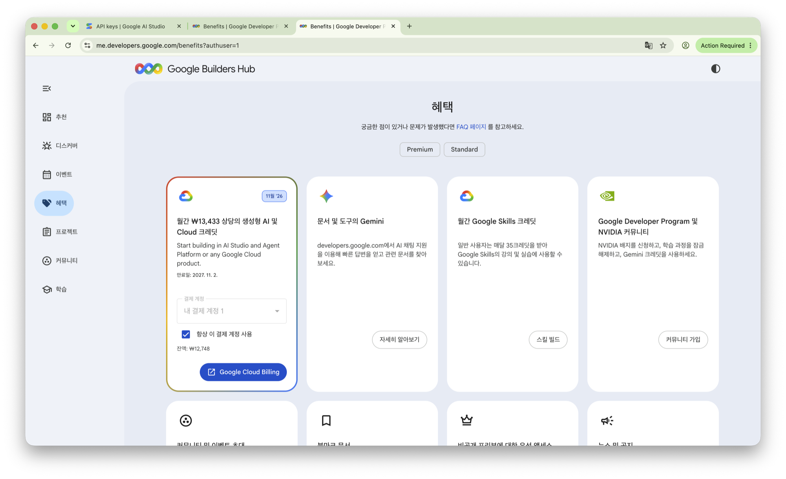
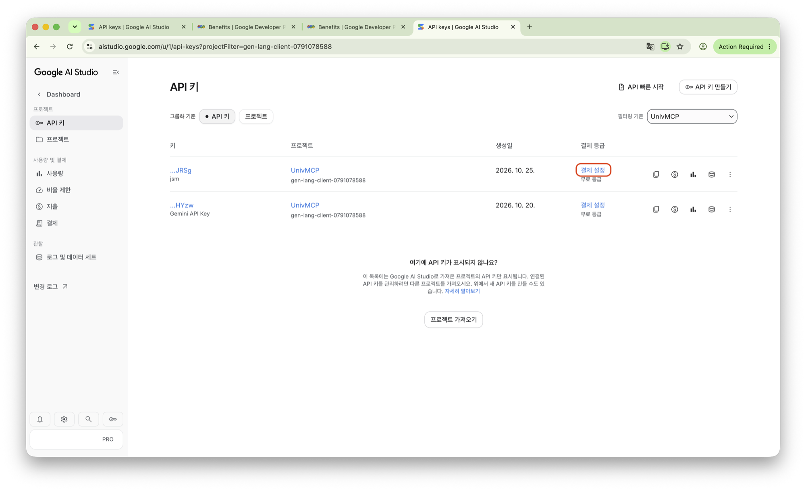
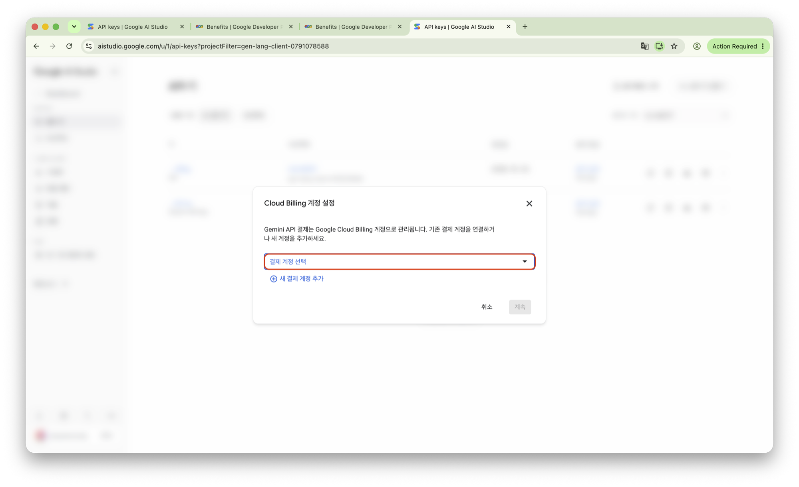
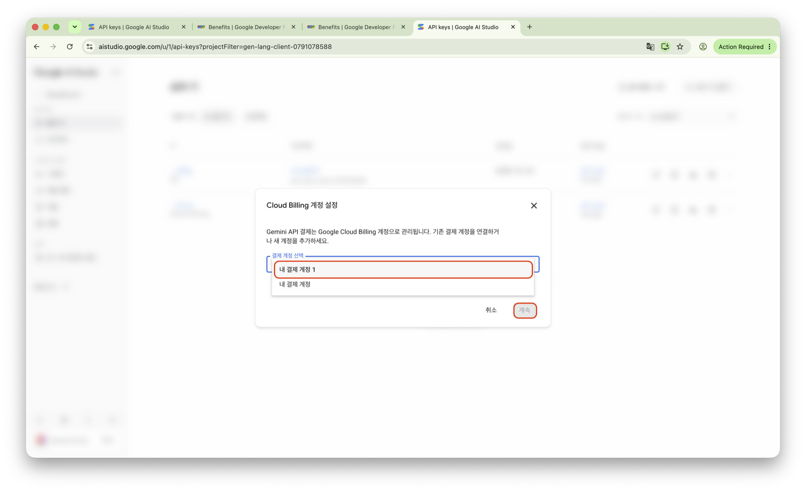

# Google AI Pro 월 $10 크레딧으로 Nalmeok 사용하기

Google AI Pro를 구독하고 있다면 매달 받는 **$10 상당의 Google Cloud 크레딧**을 Gemini API 사용에 쓸 수 있어요. Nalmeok에서도 이 크레딧으로 유료 등급의 Gemini API를 사용할 수 있어요.

> **유료 키를 권장해요.** Google AI Pro 구독자라면 매월 $10 크레딧으로 유료 키를 거의 무료로 쓸 수 있어요. Pro 구독자가 아니어도 소액의 비용을 감당할 수 있다면 유료 키를 권장해요. 무료 키는 서버가 붐빌 때 응답 품질이 들쑥날쑥할 수 있거든요.

- **대상** — Google AI Pro 구독자
- **혜택** — 매월 $10 상당의 Google Cloud 크레딧
- **준비물** — Google AI Pro 구독 계정, Google Cloud 결제 계정

이 글은 한국어 화면을 기준으로 해요. 영어 화면에서 보이는 이름은 괄호에 같이 적었어요.

## 1. Google Developer Program에 가입해요

[Google Developer Program](https://developers.google.com/program)에 접속해요.

화면 중앙의 **Join the program**(프로그램 참여) 버튼을 누르고, Google AI Pro를 구독 중인 Google 계정으로 로그인해요. 프로그램 가입 자체는 무료예요.

*사진 1 — Google Developer Program 홈페이지*

## 2. 개발자 프로필을 만들어요

프로그램에 처음 가입한다면 프로필 생성 화면이 나와요.

1. **프로그램 참여**를 눌러요.
2. 이름과 기타 프로필 정보를 입력해요.
3. **프로필 만들기**를 눌러요.

프로필 공개와 이메일 수신 여부는 원하는 대로 골라요. 프로필을 만들면 Google Builders Hub로 이동해요.

*사진 2 — Google Builders Hub에서 프로그램 참여*

*사진 3 — 개발자 프로필 만들기*

*사진 4 — 가입 완료와 Google Builders Hub*

## 3. 월 $10 크레딧 혜택을 확인해요

Google Builders Hub의 왼쪽 메뉴에서 **혜택**(Benefits)을 골라요. [Google Builders Hub 혜택](https://me.developers.google.com/benefits)으로 바로 가도 돼요.

**Premium** 탭에서 **월간 ₩13,433 상당의 생성형 AI 및 Cloud 크레딧** 카드를 볼 수 있어요. 한국 계정에서는 환율에 따라 **₩13,433**처럼 원화로 표시돼요. 카드에는 만료일과 연결된 결제 계정, 남은 잔액도 함께 보여요.

*사진 5 — Premium 혜택과 월간 크레딧*

## 4. Google Cloud 크레딧을 활성화해요

카드에서 **결제 계정**을 골라요. 크레딧을 처음 쓴다면 안내에 따라 Google Cloud 결제 계정을 새로 만들거나 기존 계정을 골라요.

**항상 이 결제 계정 사용**을 체크하면 다음에도 같은 계정을 써요. 카드 아래에 **잔액**과 **만료일**이 보이면 크레딧이 활성화된 상태예요. **Google Cloud Billing** 버튼을 누르면 결제 계정 화면으로 이동해요.

> 크레딧에는 만료일이 있어요. 혜택 카드에 표시된 기간을 확인하세요.

## 5. Gemini API 유료 결제를 설정해요

[Google AI Studio API 키 관리](https://aistudio.google.com/api-keys)에 접속해요.

1. 사용할 프로젝트의 키 줄에서 **결제 설정**을 눌러요.
2. **Cloud Billing 계정 설정** 창의 **결제 계정 선택**에서 앞서 크레딧을 연결한 계정(예: **내 결제 계정 1**)을 골라요.
3. 목록에 계정이 없다면 **새 결제 계정 추가**를 눌러 만들어요.
4. **계속**을 눌러요.

결제가 연결되면 그 프로젝트의 API 키를 유료 등급으로 쓸 수 있어요.

*사진 6 — API 키 줄의 결제 설정*

*사진 7 — Cloud Billing 계정 설정*

*사진 8 — 결제 계정 선택 후 계속*

처음 유료 등급을 설정한다면 Google 정책에 따라 결제 수단 등록과 최소 $5의 선불 충전이 필요할 수 있어요. 활성 선불 잔액이 있으면 사용 가능한 Google Cloud 크레딧이 선불 잔액보다 먼저 적용돼요.

## 6. API 키를 발급해 Nalmeok에 등록해요

API 키 화면(사진 6) 오른쪽 위의 **API 키 만들기**를 눌러요.

1. **키 이름 지정**에 이름을 넣어요. (예: `Nalmeok`)
2. 유료 결제가 연결된 프로젝트를 골라요.
3. **키 만들기**를 누르고 발급된 키를 복사해요.
4. Nalmeok을 열고 **API 키**(영어 화면 **API keys**) 화면으로 가요.
5. **유료**(**Paid**)를 골라요.
6. **API 키 붙여넣기**(**Paste an API key**) 칸에 키를 넣고 **저장**(**Save**)을 눌러요. 결제 없이 키가 맞는지 확인한 뒤 저장해요.
7. 목록에 키가 나오면 **완료**(**Done**)를 눌러 화면을 닫아요.

이제 Nalmeok에서 유료 등급의 Gemini API를 쓸 수 있어요.

> 유료 키는 Batch(대기 후 처리)에 써요. 1시간 오디오에 약 74원이고, 결과는 보통 10분~1시간 뒤에 나와요. 앱을 닫아도 Google 서버에서 계속 진행돼요. 무료 키와 유료 키의 차이는 [사용 설명서](usage.md#무료-키와-유료-키)를 봐요.

## 알아두면 좋은 점

**Google AI Pro 구독자는 매월 $10를 따로 결제해야 하나요?**

아니요. $10 크레딧은 Google AI Pro 구독에 포함된 혜택이에요. 다만 Gemini API 유료 등급을 처음 활성화할 때 별도 선불 충전이 필요할 수 있어요.

**크레딧을 모두 쓰면 어떻게 되나요?**

크레딧을 모두 쓰면 연결된 결제 계정의 일반 요금 정책이 적용돼요. 예상하지 못한 비용이 나오지 않도록 사용량과 지출 한도를 확인하세요.

**이미 발급받은 무료 API 키를 그대로 쓸 수 있나요?**

네. API 키의 무료·유료 등급은 키 자체가 아니라 연결된 Google Cloud 프로젝트의 결제 상태로 정해져요. 기존 프로젝트에 유료 결제를 연결하면 그 프로젝트의 API 키도 유료 등급으로 쓸 수 있어요. Nalmeok에서는 **유료**(**Paid**)를 골라 다시 등록하세요.

**Google AI Pro와 Gemini API는 별개인가요?**

Google AI Pro는 Google의 AI 구독 서비스이고, Gemini API는 개발자가 앱에서 Gemini 모델을 호출하는 서비스예요. Google AI Pro 구독에는 Gemini API 등에 쓸 수 있는 월간 Cloud 크레딧 혜택이 포함되어 있어요.

## 관련 링크

- [Google Developer Program](https://developers.google.com/program)
- [Google Builders Hub 혜택](https://me.developers.google.com/benefits)
- [Google AI Studio API 키 관리](https://aistudio.google.com/api-keys)
- [Google Cloud Billing](https://console.cloud.google.com/billing)
- [Gemini API 결제 안내](https://ai.google.dev/gemini-api/docs/billing)
- [Nalmeok 다운로드](https://github.com/jseook11/nalmeok/releases/latest)
- [무료 Gemini API 키 발급과 등록](gemini-api-key.md)
- [Nalmeok 사용 설명서](usage.md)
